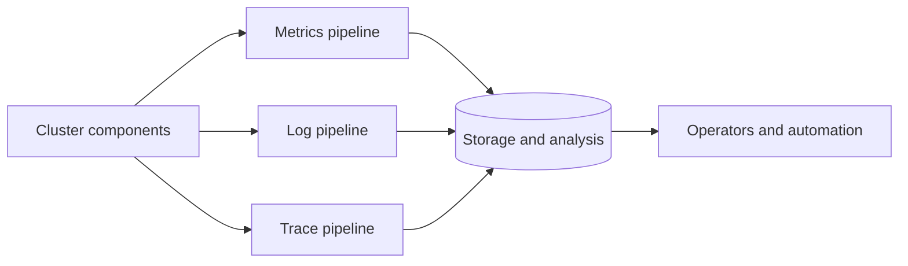
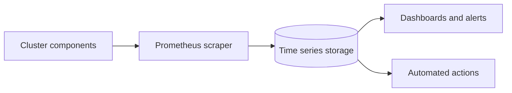
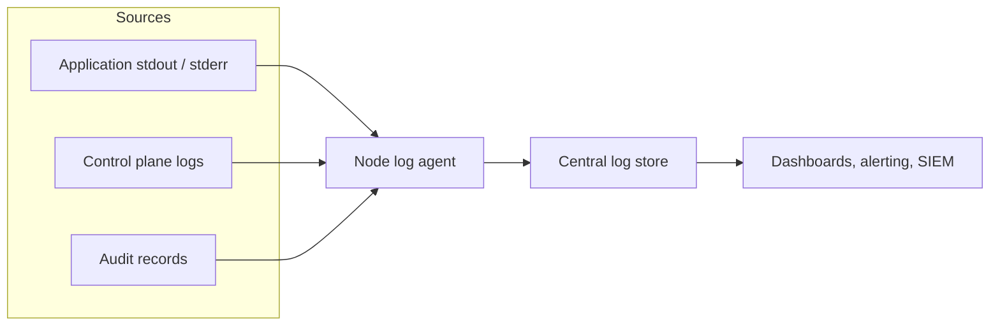
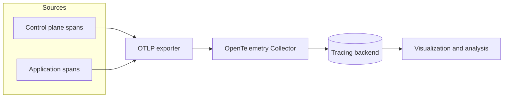

# Observability

In Kubernetes, observability is the process of collecting and analyzing metrics, logs, and traces—often referred to as the three pillars of observability—in order to obtain a better understanding of the internal state, performance, and health of the cluster.

Kubernetes control plane components, as well as many add-ons, generate and emit these signals. By aggregating and correlating them, you can gain a unified picture of the control plane, add-ons, and applications across the cluster.

Figure 1 outlines how cluster components emit the three primary signal types.

*Figure 1. High-level signals emitted by cluster components and their consumers.*

## Metrics

Kubernetes components emit metrics in [Prometheus format](https://prometheus.io/docs/instrumenting/exposition_formats/) from their `/metrics` endpoints, including:

- kube-controller-manager
- kube-proxy
- kube-apiserver
- kube-scheduler
- kubelet

The kubelet also exposes metrics at `/metrics/cadvisor`, `/metrics/resource`, and `/metrics/probes`, and add-ons such as [kube-state-metrics](/concepts/cluster-administration/kube-state-metrics.md) enrich those control plane signals with Kubernetes object status.

A typical Kubernetes metrics pipeline periodically scrapes these endpoints and stores the samples in a time series database (for example with Prometheus).

See the [system metrics guide](/concepts/cluster-administration/system-metrics.md) for details and configuration options.

Figure 2 outlines a common Kubernetes metrics pipeline.

*Figure 2. Components of a typical Kubernetes metrics pipeline.*

For multi-cluster or multi-cloud visibility, distributed time series databases (for example Thanos or Cortex) can complement Prometheus.

See [Common observability tools - metrics tools](#metrics-tools) for metrics scrapers and time series databases.

### Metrics API

**Feature state:** Kubernetes v1.37 [stable]

The Kubernetes Metrics API provides CPU and memory resource usage for nodes and Pods. The
`kubectl top` command and components such as the
[HorizontalPodAutoscaler](/concepts/workloads/autoscaling/horizontal-pod-autoscale.md)
and [VerticalPodAutoscaler](/concepts/workloads/autoscaling/vertical-pod-autoscale.md)
use this API.

`kubectl top` supports both `metrics.k8s.io/v1` and `metrics.k8s.io/v1beta1`. It prefers `v1`
when that version is available and falls back to `v1beta1`. In Kubernetes v1.37, the
HorizontalPodAutoscaler controller supports only `metrics.k8s.io/v1beta1`; support for
`metrics.k8s.io/v1` is planned but is not available yet.

Unlike the component metrics endpoints described earlier, the Metrics API is served through the
Kubernetes [API aggregation layer](/concepts/extend-kubernetes/api-extension/apiserver-aggregation.md).
Your cluster must run [Metrics Server](https://github.com/kubernetes-sigs/metrics-server) or another
implementation that provides the API. The Metrics API intentionally provides only the resource
metrics needed for autoscaling and basic inspection; it is not a replacement for a full monitoring
pipeline.

To learn about the API, its implementations, and the data flow from kubelets to its clients, see the
[resource metrics pipeline](/tasks/debug/debug-cluster/resource-metrics-pipeline.md).

#### See Also

- [System metrics for Kubernetes components](/concepts/cluster-administration/system-metrics.md)
- [Resource usage monitoring with metrics-server](/tasks/debug/debug-cluster/resource-usage-monitoring.md)
- [kube-state-metrics concept](/concepts/cluster-administration/kube-state-metrics.md)

## Logs

Logs provide a chronological record of events inside applications, Kubernetes system components, and security-related activities such as audit logging.

Container runtimes capture a containerized application’s output from standard output (`stdout`) and standard error (`stderr`) streams. While runtimes implement this differently, the integration with the kubelet is standardized through the _CRI logging format_, and the kubelet makes these logs available through `kubectl logs`.

*Figure 3a. Node-level logging architecture.*

System component logs capture events from the cluster and are often useful for debugging and troubleshooting. These components are classified in two different ways: those that run in a container and those that do not. For example, the `kube-scheduler` and `kube-proxy` usually run in containers, whereas the `kubelet` and the container runtime run directly on the host.

- On machines with `systemd`, the kubelet and container runtime write to journald. Otherwise, they write to `.log` files in the `/var/log` directory.
- System components that run inside containers always write to `.log` files in `/var/log`, bypassing the default container logging mechanism.

System component and container logs stored under `/var/log` require log rotation to prevent uncontrolled growth. Some cluster provisioning scripts install log rotation by default; verify your environment and adjust as needed. See the [system logs reference](/concepts/cluster-administration/system-logs.md) for details on locations, formats, and configuration options.

Most clusters run a node-level logging agent (for example, Fluent Bit or Fluentd) that tails these files and forwards entries to a central log store. The [logging architecture guidance](/concepts/cluster-administration/logging.md) explains how to design such pipelines, apply retention, and log flows to backends.

Figure 3 outlines a common log aggregation pipeline.

*Figure 3. Components of a typical Kubernetes logs pipeline.*

See [Common observability tools - logging tools](#logging-tools) for logging agents and central log stores.

#### See Also

- [Logging architecture](/concepts/cluster-administration/logging.md)
- [System logs](/concepts/cluster-administration/system-logs.md)
- [Logging tasks and tutorials](/tasks/debug/logging.md)
- [Configure audit logging](/tasks/debug/debug-cluster/audit.md)

## Traces

Traces capture how requests moves across Kubernetes components and applications, linking latency, timing and relationships between operations.By collecting traces, you can visualize end-to-end request flow, diagnose performance issues, and identify bottlenecks or unexpected interactions in the control plane, add-ons, or applications.

Kubernetes 1.37 can export spans over the [OpenTelemetry Protocol](/concepts/cluster-administration/system-traces.md) (OTLP), either directly via built-in gRPC exporters or by forwarding them through an OpenTelemetry Collector.

The OpenTelemetry Collector receives spans from components and applications, processes them (for example by applying sampling or redaction), and forwards them to a tracing backend for storage and analysis.

Figure 4 outlines a typical distributed tracing pipeline.

*Figure 4. Components of a typical Kubernetes traces pipeline.*

See [Common observability tools - tracing tools](#tracing-tools) for tracing collectors and backends.

#### See Also

- [System traces for Kubernetes components](/concepts/cluster-administration/system-traces.md)
- [OpenTelemetry Collector getting started guide](https://opentelemetry.io/docs/collector/getting-started/)
- [Monitoring and tracing tasks](/tasks/debug/monitoring.md)

## Common observability tools

> Items on this page refer to third party products or projects that are not part of Kubernetes itself.

Note: This section links to third-party projects that provide observability capabilities required by Kubernetes.
The Kubernetes project authors aren't responsible for these projects, which are listed alphabetically. To add a
project to this list, read the [content guide](https://kubernetes.io/docs/contribute/style/content-guide/) before submitting a change.

### Metrics tools

- [Cortex](https://cortexmetrics.io/) offers horizontally scalable, long-term Prometheus storage.
- [Grafana Mimir](https://grafana.com/oss/mimir/) is a Grafana Labs project that provides multi-tenant, horizontally scalable Prometheus-compatible storage.
- [Prometheus](https://prometheus.io/) is the monitoring system that scrapes and stores metrics from Kubernetes components.
- [Thanos](https://thanos.io/) extends Prometheus with global querying, downsampling, and object storage support.

### Logging tools

- [Elasticsearch](https://www.elastic.co/elasticsearch/) delivers distributed log indexing and search.
- [Fluent Bit](https://fluentbit.io/) collects and forwards container and node logs with a low resource footprint.
- [Fluentd](https://www.fluentd.org/) routes and transforms logs to multiple destinations.
- [Grafana Loki](https://grafana.com/oss/loki/) stores logs in a Prometheus-inspired, label-based format.
- [OpenSearch](https://opensearch.org/) provides open source log indexing and search compatible with Elasticsearch APIs.

### Tracing tools

- [Grafana Tempo](https://grafana.com/oss/tempo/) offers scalable, low-cost distributed tracing storage.
- [Jaeger](https://www.jaegertracing.io/) captures and visualizes distributed traces for microservices.
- [OpenTelemetry Collector](https://opentelemetry.io/docs/collector/) receives, processes, and exports telemetry data including traces.
- [Zipkin](https://zipkin.io/) provides distributed tracing collection and visualization.

## What's next

- Learn how to [collect resource usage metrics with metrics-server](/tasks/debug/debug-cluster/resource-usage-monitoring.md)
- Explore [logging tasks and tutorials](/tasks/debug/logging.md)
- Follow the [monitoring and tracing task guides](/tasks/debug/monitoring.md)
- Review the [system metrics guide](/concepts/cluster-administration/system-metrics.md) for component endpoints and stability
- Review the [common observability tools](#common-observability-tools) section for vetted third-party options
